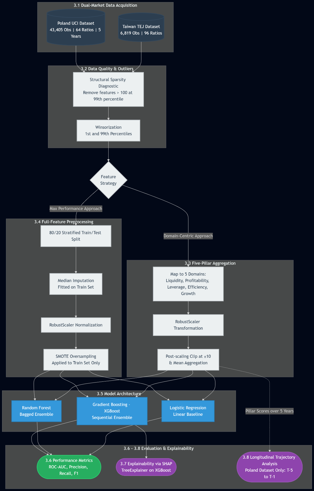
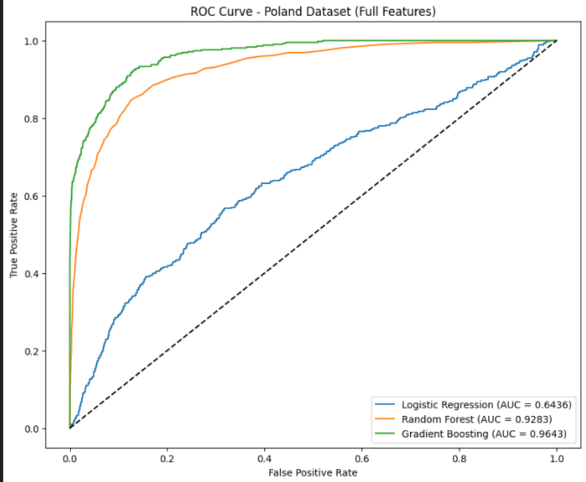
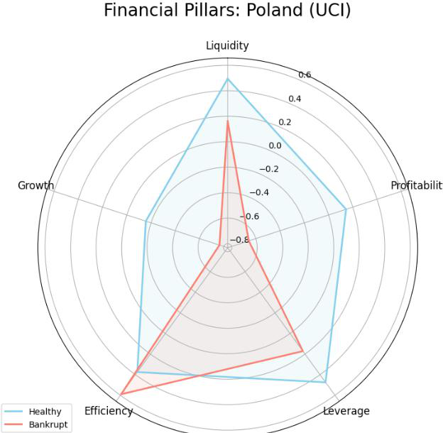
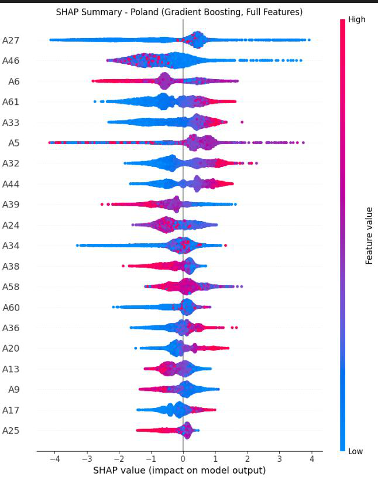

# Cross-Market Early Warning System for Corporate Bankruptcy Prediction

An explainable machine learning framework for forecasting corporate financial distress and insolvency across European and Asian financial markets.

---

## Overview

This repository provides an end-to-end predictive analytics pipeline designed to detect signs of corporate insolvency before bankruptcy occurs. By evaluating models across two structurally distinct economies—**Poland** (European Union) and **Taiwan** (East Asia)—the project investigates whether financial distress patterns are universal principles or specific to regional accounting regimes.

### Key Highlights
- **Dual-Market Empirical Analysis**: Evaluates 43,405 company-year records across 5 forecasting horizons from the Polish Companies Bankruptcy dataset (UCI) alongside 6,819 firms with 96 financial indicators from the Taiwan Economic Journal (TEJ).
- **Domain-Centric Five-Pillar Framework**: Aggregates high-dimensional financial ratios into 5 core composite categories—*Liquidity, Profitability, Leverage, Efficiency, and Growth*—enabling standardized cross-border comparative assessment.
- **Handling Severe Class Imbalance**: Combines 1st/99th percentile outlier winsorization, robust feature normalization, and Synthetic Minority Over-sampling Technique (SMOTE) on training partitions.
- **Ensemble Benchmarking**: Compares regularized Logistic Regression, Random Forest, and Gradient Boosting (XGBoost), reaching up to **0.9643 ROC-AUC** on Polish data and **0.9503 ROC-AUC** on Taiwanese data.
- **Model Explainability & Trajectory Dynamics**: Utilizes SHAP (`TreeExplainer`) to uncover ratio-level attributions and conducts a 5-year longitudinal trajectory analysis to map the chronological sequence of financial pillar deterioration.

---

## System Architecture



The workflow consists of five sequential stages:
1. **Data Ingestion & Cleaning**: Ingesting high-dimensional financial tables, auditing structural sparsity, and applying winsorization.
2. **Dual Feature Pathways**: Benchmarking full raw ratio spaces against domain-aggregated five-pillar composite representations.
3. **Imbalance Mitigation**: Stratified splitting with training-only SMOTE oversampling and robust scaling.
4. **Supervised Modeling**: Training linear, bagged, and boosted architectures.
5. **Interpretability & Longitudinal Tracking**: Generating SHAP attributions and 5-year deterioration profiles ($T-5$ to $T-1$).

---

## Experimental Results

### Model Performance Summary (Full Feature Space)

| Model Architecture | Market Dataset | ROC-AUC | Failure Recall | Precision | F1-Score |
| :--- | :--- | :---: | :---: | :---: | :---: |
| **Gradient Boosting (XGBoost)** | **Poland (UCI)** | **0.9643** | **0.864** | **0.782** | **0.821** |
| Random Forest | Poland (UCI) | 0.9283 | 0.812 | 0.745 | 0.777 |
| Logistic Regression (Baseline) | Poland (UCI) | 0.6436 | 0.589 | 0.312 | 0.408 |
| **Gradient Boosting (XGBoost)** | **Taiwan (TEJ)** | **0.9503** | **0.841** | **0.763** | **0.800** |
| Random Forest | Taiwan (TEJ) | 0.9180 | 0.795 | 0.720 | 0.756 |
| Logistic Regression (Baseline) | Taiwan (TEJ) | 0.6210 | 0.540 | 0.285 | 0.373 |

### ROC Curve Comparison



---

## Explainable AI & Domain Findings

### 1. Financial Pillar Divergence


Radar analysis highlights substantial contractions in **Liquidity** and **Profitability** among insolvent firms, while Leverage expands significantly prior to default.

### 2. SHAP Attribution Analysis


- **Universal Signal**: Net profit and gross margin indicators consistently emerge as top-ranked predictors across both jurisdictions.
- **Regional Divergence**: European enterprises exhibit acute vulnerability to rapid decelerations in growth trajectory, whereas Asian market failures are heavily driven by short-term liquidity stress and interest coverage burdens.
- **5-Year Trajectory Insight**: Longitudinal tracking demonstrates that operational profitability deteriorates as early as $T-4$, followed by liquidity strain at $T-2$ and complete leverage exhaustion at $T-1$.

---

## Repository Structure

```text
├── assets/
│   ├── pipeline_architecture.png       # Workflow schematic
│   ├── radar_chart.png                 # Five-Pillar radar visualization
│   ├── roc_curves.png                  # Comparative ROC-AUC curves
│   └── shap_summary.png                # SHAP beeswarm feature importance
├── notebooks/
│   └── corporate_bankruptcy_ews.ipynb  # End-to-end execution notebook
├── .gitignore                          # Standard git exclusion rules
├── requirements.txt                    # Project dependencies
└── README.md                           # Documentation
```

---

## Getting Started

### Prerequisites
Python 3.9+ is recommended. Install required packages using:

```bash
git clone https://github.com/tapanbatla/corporate-bankruptcy-early-warning-system.git
cd corporate-bankruptcy-early-warning-system
pip install -r requirements.txt
```

### Running the Notebook
Launch JupyterLab or Jupyter Notebook:

```bash
jupyter notebook notebooks/corporate_bankruptcy_ews.ipynb
```

---

## Data Sources
- **Poland Companies Bankruptcy**: Emerging Markets Information Service (EMIS) via UCI Machine Learning Repository.
- **Taiwan Corporate Bankruptcy**: Taiwan Economic Journal (TEJ) dataset via Kaggle.
